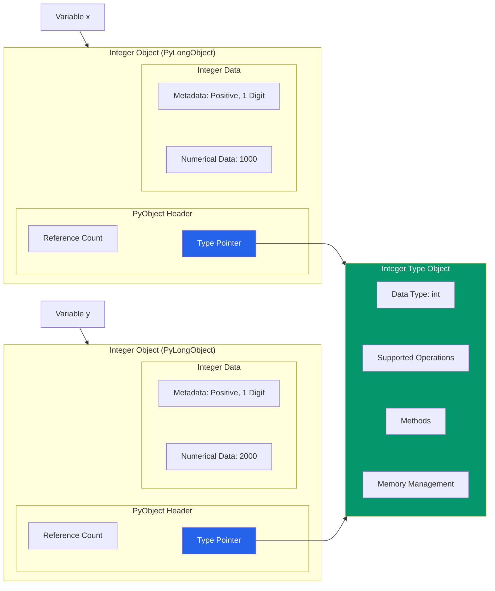

# What is Python

When python code gets compiled, it does not go down to something like **machine code** like C code does. Instead, it gets converted into something called **bytecode**. When the **bytecode** file is created, it gets an extension of `.pyc`.

Once the `.pyc` file is *created*, it then is ran by the **python virtual machine**. This is another piece of software that actually runs the python code of the `.pyc` file since this will than turn that into **machine code** the CPU can understand.

## Creating a file

To actually create a python file, make a file that ends with the extension `.py`. For example, `main.py`.

## Commits

These are used when wanting to write come detail about how something works   or what something should do without it actually affecting the output since the compiler will ignore this code. This make the code more understandable and more readable to others who need to review/work on it.

This is made by putting a # as the first thing followed by any other text. For example, `# this is a sample`.  This does not have to be the first thing in the line though to work. For example, `print("Hi") #hi again` will also still be a valid commit.

## Display content to screen

To display anything to the screen, python has a special function called `print()`. This is something called a *built in function* meaning that when python is installed it automatically comes with it and does not have to be hand made each time by each user. 

To display text to the screen, the words must be wrapped inside a pair of single or double quotes and all placed inside the parentheses. For example, `print("Hello, world!")` or `print('Hello, world!')` will display the message "Hello, world" to the terminal.

### What is a function

Going more into functions like the `print()`, these are things were some input is given and some output is given back. For example, a coffee machine just need coffee beans poured into it and the start button needs to be clicked. How the coffee machine actually makes the coffee is not the users concern, they just care about the output which is actual coffee to drink.

There are three different ways to categorize functions:

#### Built in functions

These are ones that when installing the python language automatically come with it. This means that a user can call these at any time and in any place and they will always work. Some examples of that is the `print()`, `len()`, and `input()` functions.

#### Third party libraries

These do not come with the python language when installing it, but these are also not made by the current user either. Instead, these are functions made by someone else that have to be installed onto the current system. This is basically downloading someone else's python code files onto the current system to use in personal python files being made.

These are usually called **libraries** since when downloading it will most likely not be just one file. Instead it will be many files being downloaded with many functions made by someone else that the user can now use. Some examples are **libraries** like pandas and numpy.

#### User defined functions

These are functions made by the current user as they need specific functions made to be done a certain way.

## Special characters 

There are some characters in python that have special meanings. For example, if wanting to actually print out "Hello" with the quotes included, that will not work with the `print()` function. Reason being this will confuse the program and make it think the user is trying to print two different sets of text inside the same function call.

To actually get that double or single quote inside there is when **escape sequences** need to be used. This is done with the help of the special backslash character. First put the backslash character followed by the requested special character. For example, `print("\"Hello, world\"")` will print out "Hello, world" with the quotes included. The same rule applied when wanting display a single quote or backslash.

There are also other special characters with other meanings as well. For example, `\n` will tell the program to add a newline at the end of the text so the next thing displayed appears on a different line. Another one is `\t` which will automatically add a tab spacing to the text. For example, `print("\tHello, world\n")` will add a tab of spacing to the beginning of the line and then once done add a newline at the end of that text.

## Multi line string 

There is a way to write a string of text across multiple lines without having to make multiple `print()` calls. This is done by using triple """. Write text between that like normal, but it will now save it exactly as it is formatted. For example, instead of having to write out the newline **escape sequence** each time, it can just be done manually.

```python
print("""This is some text
That goes to the
Next line""")
```

# Variables

A variable is a name that holds the assigned data to it so it can be referenced later on by that name.

## How variables work in memory

When a variable is assigned a value in Python, unlike a primitive variable in a language such as C, it does not directly hold the value in memory. Instead, a variable name is used to reference an *object* in memory.

In CPython, an object contains a common structure known as the **PyObject header**, along with additional data specific to the object's data type. The PyObject header contains the reference count and type pointer.

For example, an integer object is known internally as a **PyLongObject**, which contains the PyObject header and integer-specific data.

```python
x = 1000
y = 2000
```



### PyObject Header

The PyObject header contains two pieces of information common to CPython objects:

- **Reference Count:** Keeps track of how many references exist to the object in memory. As references are added or removed, the reference count generally increases or decreases. When the reference count of an ordinary object reaches zero, CPython deallocates the object.
- **Type Pointer:** Stores a memory address that points to another object in memory known as a *type object*. This object defines the data type, what operations can be performed, what methods are available, and how objects of that type are managed in memory.

In the example above, although variables x and y reference two separate integer objects, their type pointers point to the same integer type object. This eliminates the need to store the same type information and functionality within every individual integer object.

> Side note: The reference count tracks references from more than just variables. Other objects, such as lists and dictionaries, can also reference an object.

### Object-Specific Data

In addition to the PyObject header, an object contains data specific to its data type. For an integer object in CPython 3.12, this consists of two components:

- **Metadata:** Contains information about how the numerical data should be interpreted, including whether the integer is positive, negative, or zero and how many internal digits are used to represent it.
- **Numerical Data:** Contains the numerical magnitude of the integer itself.

> **Side note:** Internal digits are not the same as decimal digits. CPython typically uses 30 bits per internal digit, which means that both `1000` and `2000` require only one internal digit.

The PyObject header, metadata, and numerical data are not separate Python objects. They are all components of the same integer object in memory. However, the type object that the type pointer references **is a separate object in memory**.

> Side note: While all CPython objects share the common PyObject header, the structure of their object-specific data differs depending on the data type. The diagram above is a simplified representation of an integer object in CPython 3.12.
